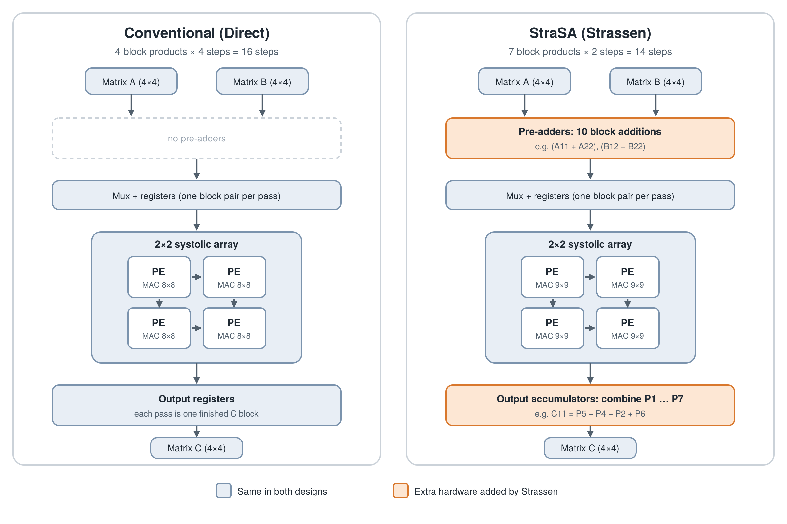

# StraSA: Strassen-Based Systolic Array

**Does Strassen help in hardware? Evaluating a Strassen-based systolic array against a conventional design for 4×4 matrix multiplication.**

Strassen's algorithm is known for doing a block matrix multiply with 7 multiplications instead of 8. In software this is a clear win, because multiplications are expensive. This project asks whether that saving still holds when the multiplications run on a systolic array, where the multipliers are fixed hardware.

Therfore, I designed two 4×4 matrix multipliers that share the same 2×2 systolic array: one conventional (direct) and one using Strassen's algorithm (StraSA). I took both through RTL simulation, synthesis on the SkyWater 130 nm process, and static timing analysis, and then compared them on area, clock speed, latency and throughput.

**Short answer: no.** StraSA saves cycles, but it ends up slightly slower overall and almost twice the area.



---

## Designs

Both designs multiply two 4×4 matrices of signed 8-bit numbers (two's complement) and produce a 4×4 result with 18-bit entries. Each matrix is split into four 2×2 blocks, and the block products are streamed through one shared **2×2 output-stationary systolic array** (4 PEs, each a multiply-accumulate unit).

**Conventional (Direct)**
- Computes each output block directly, one block per pass.
- 4 passes × 4 steps = **16 steps**.
- 8×8-bit multipliers in the PEs. No extra adders.

**StraSA (Strassen)**
- Computes the 7 Strassen block products (P1 to P7), one per pass.
- 7 passes × 2 steps = **14 steps**.
- Needs **pre-adders** to form the block sums before they enter the array, and **output accumulators** to combine P1 to P7 into the final C blocks.
- The pre-adds grow the operands from 8 to 9 bits, so the PE multipliers are 9×9 instead of 8×8.

Strassen's formulas used:
```
P1 = A11(B12 − B22)        P5 = (A11 + A22)(B11 + B22)
P2 = (A11 + A12)B22        P6 = (A12 − A22)(B21 + B22)
P3 = (A21 + A22)B11        P7 = (A11 − A21)(B11 + B12)
P4 = A22(B21 − B11)

C11 = P5 + P4 − P2 + P6    C12 = P1 + P2
C21 = P3 + P4              C22 = P5 + P1 − P3 − P7
```

A few design choices common to both:
- **Tags travel with the data.** Each operand carries a pass ID and first/last flags through the array, so passes can run back to back with no clear cycle in between.
- **Accumulate on capture (StraSA).** Each output block adds or subtracts a product the moment it leaves the array, instead of waiting for all 7 products.
- **Exact arithmetic.** Bit widths are sized so nothing overflows, so both designs are exact over the full input range (−128 to 127).

---

## Tool flow

| Step | Tool |
|---|---|
| RTL simulation | Icarus Verilog |
| Synthesis | Yosys + ABC, SkyWater sky130_fd_sc_hd standard cells (TT corner, 25 °C, 1.8 V) |
| Static timing, area, leakage | OpenTimer |
| Gate sizing | Manual drive-strength upsizing in OpenTimer |

---

## Results

All numbers are pre-layout, at the TT corner, with a 20 ns reference clock. Throughput counts 128 operations (64 multiply-accumulates) per 4×4 matrix multiply for both designs.

| | Direct | StraSA | StraSA (after upsizing) |
|---|---|---|---|
| Area | 46,585 µm² | 90,466 µm² | ~90,476 µm² |
| Min clock period | 5.59 ns | 12.28 ns | 6.50 ns |
| fmax | **178.8 MHz** | 81.4 MHz | **154.0 MHz** |
| Cycles (start to done) | 20 | 18 | 18 |
| Latency | **111.9 ns** | 221.0 ns | 116.9 ns |
| Throughput | **1.14 GOPS** | 0.58 GOPS | 1.10 GOPS |
| Throughput per area | **24.6 GOPS/mm²** | 6.4 GOPS/mm² | 12.1 GOPS/mm² |
| Leakage power | 20.8 nW | 39.8 nW | 39.8 nW |
| Critical path | PE multiply-accumulate | Step counter fanout | Output accumulators |

---

## Observations

1. **Strassen saves cycles, but not time.** StraSA finishes in 18 cycles instead of 20. However, its clock is slower, so its total latency comes out about 5% worse than the direct design.

2. **Almost twice the area.** The 4 PEs are the same in both designs, so the saved multiplication does not remove any hardware. Instead, StraSA adds 10 block pre-adders, 16 output accumulators and wider 9×9 multipliers. That brings it to 1.94× the area of the direct design.

3. **About half the throughput per area.** Combining the two results above, StraSA delivers 12.1 GOPS/mm² against 24.6 GOPS/mm² for the direct design.

4. **The extra adders end up setting the clock.** In the first synthesis run, StraSA's critical path came from a high-fanout control signal: one flip-flop in the step counter was driving the select lines of every feed multiplexer. Upsizing that flip-flop, its neighbour and two buffers on that net cut the clock period from 12.28 ns to 6.50 ns, for about 10 µm² of extra area. After that, the critical path moved to the Strassen output accumulators (the add/subtract stage after the array). The direct design has no such stage, so its clock is limited only by the PE multiply-accumulate.

**Why this happens:** in a systolic array the multipliers are built into every PE and the PE count is fixed. Strassen's saved multiplication is therefore "free" hardware that was going to be there anyway, while its extra additions are new hardware that costs both area and critical-path delay. This is consistent with why production matrix accelerators such as Google's TPU use direct multiplication.

---

## Limitations

- Results are pre-layout (no placement, routing or wire load) at a single corner.
- Synthesis used the full sky130 library, so a few low-power (lpflow) cells were picked by the mapper. They appear in both designs.
- The study is at one size (4×4) and one precision (8-bit). Each new matrix multiply starts only after the previous one finishes, so back-to-back throughput (14 vs 16 steps) was not measured directly.

## Future work

- Larger matrices with recursive Strassen, and wider bit widths, where multipliers cost relatively more.
- Sharing the pre-adders between passes to reduce StraSA's area.
- The Winograd variant of Strassen, which needs fewer additions.
- Looking at how this trade-off changes in compute-in-memory designs.

---

## Repository structure

```
rtl/
  direct/          Direct design: top, systolic array, PE, multiplier, adder
  strasa/          StraSA design: same blocks plus the 2×2 block pre-adder
tb/                Self-checking testbenches (3 test matrices each)
constraints/       SDC timing constraints
scripts/           Yosys and OpenTimer scripts, liberty helper (make_ot_libs.py)
netlists/          Gate-level netlists from Yosys, plus the upsized StraSA netlist
reports_and_logs/  Yosys logs, OpenTimer timing/area/power reports
sim-results/       Simulation logs and waveforms
docs/              Block diagram
```

## How to run

The scripts expect the RTL, scripts, constraints and liberty files in one working folder. Set the liberty path in the Yosys scripts to your own sky130 install.

**Simulation**
```
iverilog -g2012 -o strasa tb/tb_strasa.sv rtl/strasa/*.v && vvp strasa
iverilog -g2012 -o direct tb/tb_direct.sv rtl/direct/*.v && vvp direct
```

**Synthesis**
```
yosys -c strasa_yo.tcl
yosys -c dir_yo.tcl
```

**Timing**
```
python3 make_ot_libs.py <path_to>/sky130_fd_sc_hd__tt_025C_1v80.lib
ot-shell -i strasa_ot.tcl
ot-shell -i strasa_ot_repower.tcl
ot-shell -i dir_ot.tcl
```
